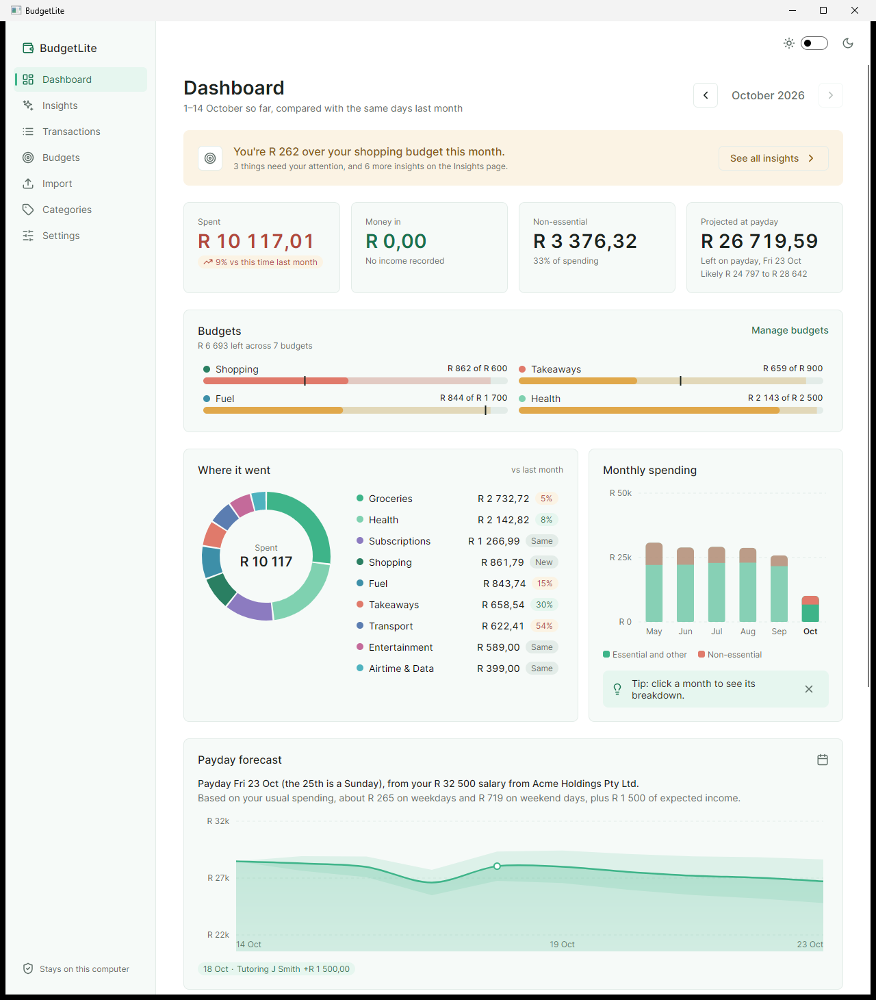
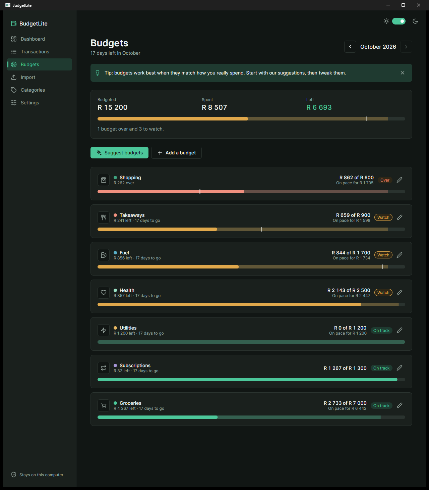

# BudgetLite

**Your bank statements, finally explained.**

BudgetLite is an offline budget app for South Africans. Drop in your bank statements and it shows you where your money went, how your budgets are tracking, and what your balance will look like on payday.

Everything stays on your computer. No account, no cloud, no internet connection needed.




<details>
<summary>Dark mode</summary>



</details>

*Screenshots use the fictional sample statements in [`samples/`](samples).*

## Features

- **Statement import:** reads CSV and PDF statements, including password-protected PDFs. Duplicate transactions are skipped when statements overlap.
- **Balance checks:** every import is checked against the statement's running balance, so a missed or misread line shows up straight away.
- **Automatic categories:** transactions are sorted into categories such as Groceries, Fuel and Subscriptions. You can add your own rules.
- **Budgets that look ahead:** each budget projects where the month will end, not just what you've spent so far, and warns you before you go over.
- **Insights:** spending pace compared with last month, what subscriptions cost per year, and which categories need attention.
- **Payday forecast:** predicts your balance on payday, including the likely range. It learns from your history whether your salary moves to the Friday before when the 25th falls on a weekend.
- **Your data, your folder:** plain JSON files you can back up, restore or move to a synced drive or USB stick.
- **Light and dark themes,** with smooth animations throughout.

## How it works

### Reading statements

Bank statements come in many layouts, so BudgetLite doesn't rely on a template per bank. It works out the layout from the document itself.

**PDF statements**, read with [PdfPig](https://github.com/UglyToad/PdfPig):

1. Every word is pulled out with its position on the page, and words on the same baseline are grouped into lines.
2. The header row ("Date, Description, Debit, Credit, Balance") gives each column an anchor. Amounts are matched to the nearest money column by their right edge, because figures are right-aligned.
3. A line with a date and an amount is a transaction. Lines just below it with neither continue its description.
4. The running balance confirms each amount. It also settles signs the layout leaves unclear, such as FNB's "Cr" suffix, and whether the statement runs oldest-first or newest-first.
5. Dates without a year ("14 Mar") take theirs from the statement period, stepping back a year for December entries on a January statement.

Text-based PDFs downloaded from online banking work best. Scanned or photographed statements are images with no text in them, and there's no OCR, so BudgetLite detects these and asks for a CSV or a downloaded PDF instead.

**CSV exports**, read with [CsvHelper](https://github.com/JoshClose/CsvHelper): the delimiter, header row and columns are detected automatically. Values are parsed in the South African style (day-first dates; "1 234,56" and "1,234.56" both work). If there's no recognisable header, columns are inferred from what the values look like.

The bank is recognised from the statement text (FNB, Absa, Standard Bank, Nedbank, Capitec, Discovery Bank, TymeBank, African Bank and Investec), and descriptions are cleaned of card numbers, references and timestamps so merchants group together.

### Analysis

- **Recurring payments:** debits are grouped by merchant, then kept when the gaps between them fit a regular cadence and the amounts stay close. Subscriptions are allowed to drift a little for annual price increases.
- **Forecast:** the app walks day by day from your last known balance to payday. Each day subtracts your typical spend for that weekday over the last 12 weeks, and scheduled debit orders and income land on their dates. Unusually large one-off purchases are left out, so a new fridge doesn't make every future day look expensive. The likely range widens with the square root of the days ahead.
- **Budgets:** a month in progress is projected as what's already spent, plus your usual spending for the days left, plus recurring payments still due. Suggested limits come from the average of your last three complete months.

### Storage

Data is saved as versioned JSON with System.Text.Json. Each write goes to a temporary file first and is then swapped in with a rename, so a crash or power cut never leaves a half-written file.

## Tech stack

| | |
|---|---|
| Language | C# (latest) on .NET 10 |
| UI | [Avalonia 12](https://avaloniaui.net) with the Fluent theme and Inter font |
| Architecture | MVVM with [CommunityToolkit.Mvvm](https://github.com/CommunityToolkit/dotnet) and Microsoft.Extensions.DependencyInjection |
| Charts | Custom-drawn Avalonia controls (donut, bar, line and budget bars) |
| PDF parsing | [PdfPig](https://github.com/UglyToad/PdfPig) |
| CSV parsing | [CsvHelper](https://github.com/JoshClose/CsvHelper) |
| Storage | System.Text.Json with source generation |
| Tests | xUnit |
| Packaging | Self-contained single-file executable |

## Download

Get the latest version from the [Releases](../../releases) page:

- **Windows:** download `BudgetLite-win-x64.zip`, extract it and run `BudgetApp.exe`. Nothing needs to be installed.
- **Linux:** download `BudgetLite-linux-x64.zip`, extract it, then run `chmod +x BudgetApp` and `./BudgetApp`.

The Windows build isn't code-signed, so SmartScreen may show a warning the first time. Click **More info**, then **Run anyway**.

To try it without your own statements, import the files in [`samples/`](samples).

## Your data

By default your data is saved in:

- Windows: `%APPDATA%\BudgetApp`
- Linux: `~/.config/BudgetApp`

You can move it to another folder from Settings, and back it up or restore it from there as well.

## Building from source

You need the [.NET 10 SDK](https://dotnet.microsoft.com/download).

```
git clone https://github.com/LoweNoe/BudgetLite.git
cd BudgetLite
dotnet run --project src/BudgetApp.UI
```

Run the tests:

```
dotnet test
```

Build a self-contained single-file executable:

```
dotnet publish src/BudgetApp.UI -c Release -r win-x64 -o publish/win-x64
```

Swap `win-x64` for `linux-x64` or `osx-arm64` to build for another platform.

## Project layout

| Folder | Contents |
|---|---|
| `src/BudgetApp.Core` | Models, categorisation, budgets, insights and forecasting |
| `src/BudgetApp.Import` | CSV and PDF statement parsing |
| `src/BudgetApp.Data` | JSON storage, backups and data location |
| `src/BudgetApp.UI` | The Avalonia desktop app: views, view models, charts and themes |
| `tests/BudgetApp.Tests` | Unit tests |
| `samples` | Fictional statements for trying the app |

## Disclaimer

BudgetLite is a personal budgeting tool, not financial advice. Always check figures against your bank statements before relying on them.

## License

[MIT](LICENSE). Third-party components are listed in [THIRD-PARTY-NOTICES.txt](THIRD-PARTY-NOTICES.txt).
